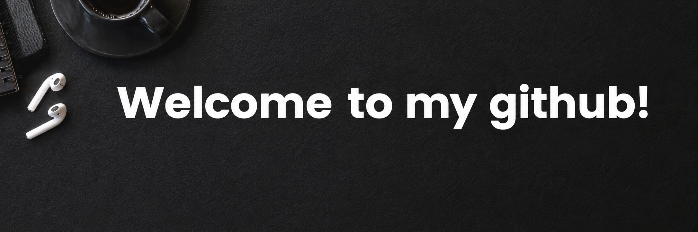

<h1 align="center"> Hey there! 👋 I'm Aayu (notayushsingh) </h1>

<h3 align="center"> Aspiring Developer | Cybersecurity Enthusiast </h3>

I'm currently building myself into this platform . I enjoy learning how things work behind the scenes and experimenting with new technologies.

Just Tryna be better slow & steady!🧢

---

## 🚀 About Me

- 🌱 Currently learning Python, Linux and Cybersecurity
- 💻 Programming experience with Java
- 🔐 Interested in Ethical Hacking and Information Security
- 🐧 Exploring the Linux environment using Ubuntu
- 🎯 Working towards building practical projects and participating in CTFs.

---

## 🛠️ Technologies & Tools

### Languages

- Java
- HTML
- Python (Learning)

### Tools & Platforms

- Git & GitHub
- VS Code
- Ubuntu Linux

---

## 🎯 Currently Exploring

- Python Programming
- Linux Fundamentals
- Networking & Cybersecurity Basics
- Git, GitHub and Open Source
- Capture The Flag (CTF) Challenges

---

Although i don't know have enough tech stacks to showcase but i'll keep improving and updating myself.

⭐ Thanks for visiting my profile!
